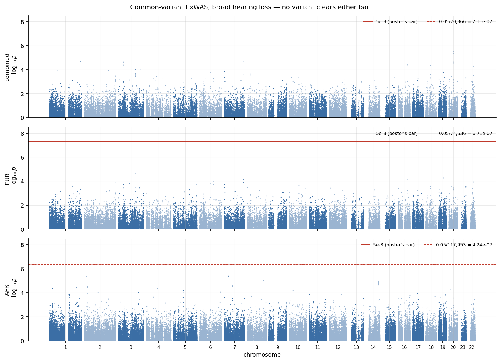
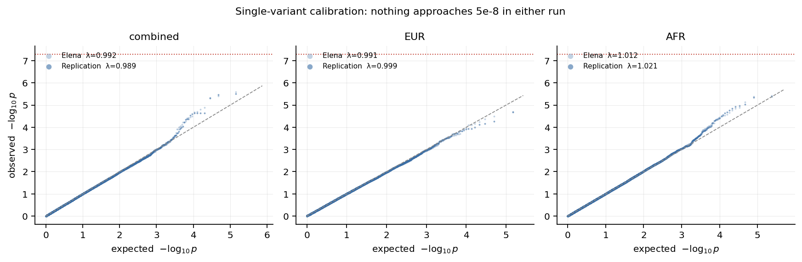
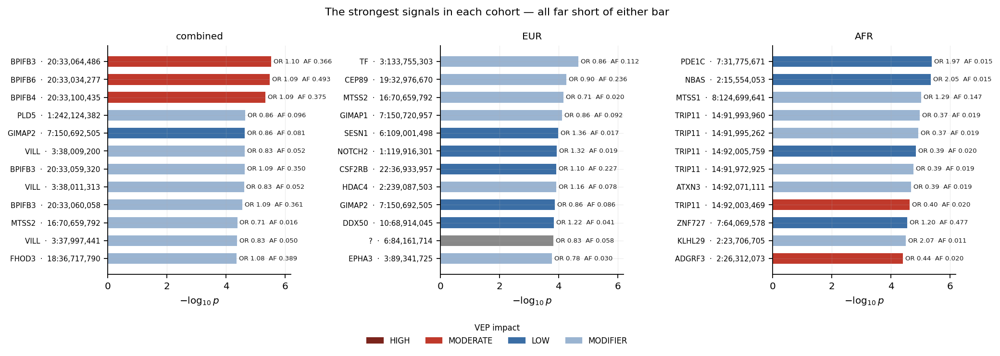
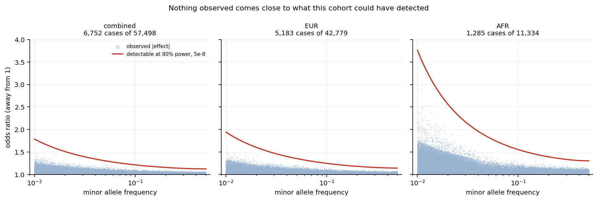
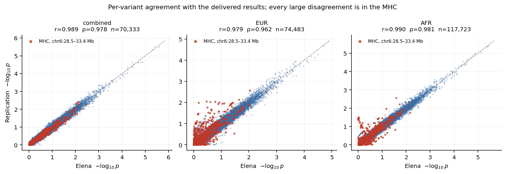
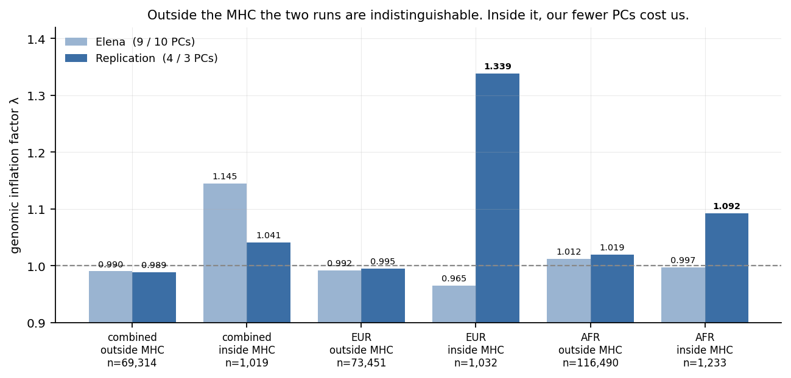
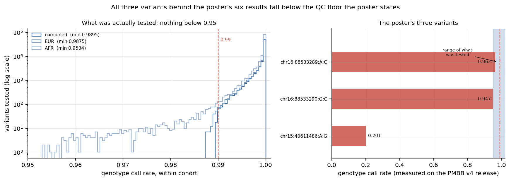
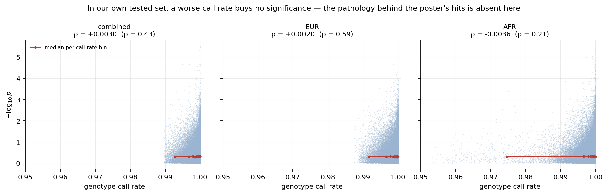

# Common-variant ExWAS, broad hearing loss — replication close-out

**Hall Lab × Epstein Lab · PMBB-Release-2026-4.0 · October 2026**
SAIGE single-variant · MAF ≥ 0.01 · 3 cohorts × 22 chromosomes

---

## Summary

This is the **single-variant, common-variant** arm of the hearing-loss pipeline — the
upper branch of the original diagram, not the rare-variant gene burden.

```
ExWAS                     MAF >= 0.01                  -> SAIGE        <- this document
Rare Variant Gene Burden  MAF <= 0.01, 0.001, 0.0001   -> SAIGE-GENE
```

Four things came out of it:

1. **Nothing is significant.** Minimum p is 3.02e-06 / 2.12e-05 / 4.11e-06 against a
   primary bar of 5e-8. Neither run — ours or the one delivered in October — finds a
   variant.
2. **The replication is excellent.** Per-variant agreement with the delivered results is
   r = 0.98–0.99, with 99.8–99.9% of the same variants tested.
3. **The null is explained, not merely stated.** At this cohort size the study could only
   have detected odds ratios of 1.2 and above for the most common variants, and 1.8 and
   above at 1% frequency. Nothing of that size exists in the data, and nothing of that
   size is expected for common variants in a complex, age-related trait.
4. **The summer poster's six genome-wide significant results rest on variants that fail
   the quality filter the poster itself describes.** One of them is genotyped in 20% of
   the cohort. This is covered in its own section and in a separate memo.

---

## What this arm inherited, and why

The arm contains only phases 2, 4 and 5. Cohort, covariates and the SAIGE null model
come from the matching burden arm rather than being rebuilt.

| | source |
|---|---|
| cohort | `gene_burden_elena_replication/phase_1/` |
| covariates | `gene_burden_elena_replication/phase_3/results/covariates/` |
| step 1 null models | `gene_burden_elena_replication/phase_4/results/step1/` |
| genotypes | `elena/rarevariant_geneburden/plink_deduplicated/` |

The null model does not depend on the MAF filter — same people, same phenotype, same
covariates, same relatedness — so refitting it would reproduce the same numbers at the
cost of 1.45 billion relatedness pairs. **The original analysis did the same thing**; its
config sets `step1_outdir` to the rare-variant run's output.

The genotypes are the files both burden arms already read and the files the original
ExWAS read, so there is no opportunity for this arm to diverge from the others on
genotypes.

| cohort | samples | cases | PCs |
|---|---:|---:|---:|
| combined | 57,498 | 6,752 | 5 |
| EUR | 42,779 | 5,183 | 4 |
| AFR | 11,334 | 1,285 | 3 |

PC counts are ours, chosen on scree plots, rather than the original 5/9/10. That
deviation has a measurable cost, reported below.

---

## What is tested, and against what bar

Of 13,223,743 variants on file, roughly half a percent clear MAF ≥ 0.01. The threshold
is applied by SAIGE on the whole cohort, so a variant's eligibility depends on which
cohort is being analysed.

| cohort | tested | share of file | secondary bar `0.05/n` |
|---|---:|---:|---:|
| combined | 70,366 | 0.53% | 7.11e-07 |
| EUR | 74,536 | 0.56% | 6.71e-07 |
| AFR | 117,953 | 0.89% | 4.24e-07 |

**Two bars are reported, both fixed before step 2 ran.** The primary is 5e-8, the
convention and the threshold the poster used. The secondary is Bonferroni over the tests
actually performed, which for exome-only testing lands near 1e-7 — about ten times
*less* strict. Pre-registering both means a variant landing between them gets described
rather than argued about. None did.

Two features of the census are worth carrying forward:

- **The combined cohort tests fewer variants than EUR alone** (70,366 against 74,536)
  despite 14,719 more samples. Pooling pushes variants that are common in one ancestry
  below 1% overall. The combined set is not a superset of the ancestry-specific ones.
- **AFR's 43,000 extra variants sit almost entirely in the 1–5% band.** In the truly
  common band it tests fewer than EUR. Real diversity and noisier MAF estimation at
  n = 11,334 both produce this and the census cannot separate them; either way AFR gets
  the loosest bar precisely where its individual tests are weakest.

---

## Results

**No variant clears either bar in any cohort.**



| cohort | tested | min p | hits at 5e-8 | hits at secondary |
|---|---:|---:|---:|---:|
| combined | 70,366 | 3.02e-06 | 0 | 0 |
| EUR | 74,536 | 2.12e-05 | 0 | 0 |
| AFR | 117,953 | 4.11e-06 | 0 | 0 |

The best result anywhere is 4.3× short of the loosest bar and 60× short of the primary.

Calibration is clean in both runs, and the poster's claim of "adequate statistical
calibration and minimal evidence of systematic inflation" reproduces:



### The strongest signals



Two of the three cohorts put a **locus**, not a single variant, at the top:

- **combined** — four variants across `BPIFB3`, `BPIFB4` and `BPIFB6` at chr20:33.0–33.1 Mb,
  three of them missense, all at OR ≈ 1.09–1.10 and p ≈ 3–5e-06. One signal in linkage
  disequilibrium, not four findings.
- **AFR** — five variants spanning `TRIP11` and `ATXN3` at chr14:91.97–92.07 Mb, all at
  OR ≈ 0.37–0.40 and AF ≈ 0.019. Again one haplotype.
- **EUR** — `TF` (transferrin, chr3) leads at 2.12e-05, intronic.

None of this is a result. It is recorded because "the top of the list was a coherent
locus rather than scattered points" is worth knowing if the phenotype is ever run on a
larger cohort.

---

## Why nothing was found

A null is only informative next to what would have been findable.



Odds ratio detectable at 80% power, α = 5e-8:

| cohort | MAF 1% | MAF 5% | MAF 10% | MAF 25% | MAF 50% |
|---|---:|---:|---:|---:|---:|
| combined | 1.78 | 1.30 | 1.21 | 1.14 | 1.12 |
| EUR | 1.94 | 1.35 | 1.25 | 1.16 | 1.14 |
| AFR | 3.76 | 1.83 | 1.55 | 1.36 | 1.30 |

Common-variant effects on complex, age-related traits typically sit at OR 1.05–1.15.
**This cohort is powered only at the very top of that range, and only for the most
frequent variants.** At 1% frequency it would take an odds ratio of 1.8 — an effect size
that essentially does not occur for common variants in traits of this kind.

So the honest reading of the null is *"no common-variant effect larger than this cohort
could see"*, not *"no common-variant effect"*.

Two caveats on the figure, both making it more conservative than it looks:

- The power calculation assumes an additive model with no loss to covariate adjustment or
  relatedness, so it is mildly **optimistic**; the true detectable effect is a little
  larger than the curve.
- A handful of AFR points sit above the curve at low frequency. Those are *estimates*,
  which are noisy and upward-biased near the frequency floor in a small cohort. None of
  them reached significance, which is the point.

---

## Quality of the replication

This is the headline for the pipeline rather than for the biology.



| cohort | delivered | ours | shared | Pearson r | Spearman ρ | λ delivered | λ ours |
|---|---:|---:|---:|---:|---:|---:|---:|
| combined | 70,429 | 70,366 | 70,333 (99.9%) | 0.989 | 0.978 | 0.992 | 0.989 |
| EUR | 74,528 | 74,536 | 74,483 (99.9%) | 0.979 | 0.962 | 0.991 | 0.999 |
| AFR | 117,943 | 117,953 | 117,723 (99.8%) | 0.990 | 0.981 | 1.012 | 1.021 |

Spearman is reported beside Pearson because with nothing significant, r is dominated by
the bulk of p-values near zero where both runs are measuring noise — agreeing about
nothing is easy. Rank agreement is the stricter test and it holds.

The few hundred variants appearing on only one side come from the cohort correction: ours
has 40 more cases and 174 fewer controls, which moves a handful across the 1% line in
both directions.

**Every per-variant disagreement larger than one log unit is in the MHC** — 14 of 14 in
EUR, 16 of 16 in AFR. Not most of them: all of them.

---

## A limitation of this replication

Splitting λ by region exposes a cost of our PC choice that the whole-genome figure hides.



| cohort | λ outside MHC (delivered / ours) | λ inside MHC (delivered / ours) |
|---|---|---|
| combined | 0.990 / 0.989 | **1.145** / 1.041 |
| EUR | 0.992 / 0.995 | 0.965 / **1.339** |
| AFR | 1.012 / 1.020 | 0.998 / **1.092** |

Outside the MHC the two runs are indistinguishable. Inside it, in EUR and AFR, **our 4
and 3 PCs leave residual inflation that the original's 9 and 10 do not.**

The MHC is the most polymorphic region of the genome and the one where ancestry structure
is strongest, so it is exactly where additional PCs do real work. Our scree-based counts
remain defensible genome-wide — outside the MHC they cost nothing — but in that window the
original's choice is better.

No conclusion depends on it: λ = 1.34 across 1,032 variants does not manufacture a 5e-8
result, and EUR's minimum p is 2.12e-05. It is reported so that no future analysis
inherits 4 PCs unexamined. In the combined cohort the direction reverses.

---

## The poster's six significant results

The summer poster reports, under *"Genome Wide Significant Results Total: 6"*, three
unique variants at p 3.51e-12 to 6.18e-09 in `KNL1` and `ZFPM1`.

None appears in the delivered results, in the raw SAIGE output, or in ours. **All three
exist in the PMBB v4 release, and all three fail the filter the poster's own methods
describe** — *"variants with a genotype call rate < 0.99 ... were removed"*:



| variant | call rate | MAF | poster p | passes the stated QC? |
|---|---:|---:|---:|---|
| chr15:40611486:A:G | **0.2013** | 0.284 | 3.51e-12 | no |
| chr16:88533289:A:C | 0.9617 | 0.295 | 2.46e-10 | no |
| chr16:88533290:G:C | 0.9473 | 0.283 | 2.52e-10 | no |

The variant carrying the 3.51e-12 has a genotype call in 20% of participants — 56,646 of
70,925 are missing. Differential missingness between cases and controls is the standard
way such a variant produces a p-value of that size, and excluding it is what a call-rate
filter is for.

Where the genes themselves are present, they carry no signal: best p 0.33 for `KNL1` and
0.26 for `ZFPM1` in the delivered results.

**This is not a disagreement between two analyses.** The two analyses agree at r = 0.99,
and the delivered tables' own `Significance` column reads "Not significant" throughout.
The poster disagrees with the output of the pipeline it describes.

The likely explanation is chronology — the poster was prepared over the summer, QC was
tightened afterwards, and the delivered files date from 2 October. The open question,
addressed to the group rather than settled here, is **which variant set produced the
poster's table**. Details and the suggested next step are in
[`memo_poster_qc.md`](memo_poster_qc.md).

### The same test, applied to ourselves

Having found that, this arm owes the same scrutiny of its own data: among the variants we
tested, does a worse call rate buy a smaller p-value?



| cohort | ρ (call rate vs −log₁₀p) | p | median call rate, top 100 | rest |
|---|---:|---:|---:|---:|
| combined | +0.0030 | 0.43 | 0.99987 | 0.99990 |
| EUR | +0.0020 | 0.59 | 0.99992 | 0.99988 |
| AFR | −0.0036 | 0.21 | 0.99991 | 0.99991 |

No relationship, in any cohort, by any of the three measures. Everything tested here sits
between call rate 0.9534 and 1.0, median 0.9999. The pathology behind the poster's hits
is absent from this arm.

---

## What we would do next

| | |
|---|---|
| **Resolve the poster's variant set** | the one open item that is not ours to settle. Until then the poster's numbers and the delivered numbers are not on the same axis. |
| **Revisit PCs for the MHC** | 4 and 3 are enough genome-wide and not enough in chr6:28.5–33.4 Mb. Any analysis targeting that region should refit. |
| **The bilateral ExWAS** | `exwas_pmbb_bilateral/`, scaffolded and pre-registered, not yet run. It completes the 2×2 against the burden arms. |
| **Not: more common-variant work on this cohort** | the power analysis above is the argument. At 6,752 cases a common-variant ExWAS can only see effects that this trait does not produce. The rare-variant arms remain the better use of the same data, which is also where the group's earlier judgement pointed. |

---

## Reproducibility

Every number and figure in this document regenerates from the scripts below.

| | |
|---|---|
| `phase_2/scripts/` | MAF census — the bar denominators, fixed before step 2 |
| `phase_4/scripts/01_saige_step2.bsub` | 66 tasks, step 1 inherited |
| `phase_4/scripts/02_merge_results.py` | refuses on in-flight jobs, header drift, field counts, row counts outside the census bound, p-values outside (0,1] |
| `phase_5/scripts/01_calibration_and_concordance.py` | λ, r, ρ, MHC attribution |
| `phase_5/scripts/02_poster_audit.py` | reads the claims from the `.pptx`, measures each variant on the release, refuses to report an unmeasured variant as an absent one |
| `phase_5/scripts/04_power.py` | the detectable-effect curves |
| `phase_5/scripts/05_qc_and_top_hits.py` | the self-check and the annotated top variants |
| `phase_5/scripts/03_figures.py`, `06_more_figures.py` | all eight figures |

Pre-registered premises are in [`PREMISES.md`](../PREMISES.md); P7 was amended after
phase 4 once the poster's variants were shown not to exist in the data, and the amendment
is recorded rather than silently applied. Full findings in
`phase_4/results/FINDINGS.md` and `phase_5/results/FINDINGS.md`. Portuguese
walk-throughs in `andre_notes/`.
