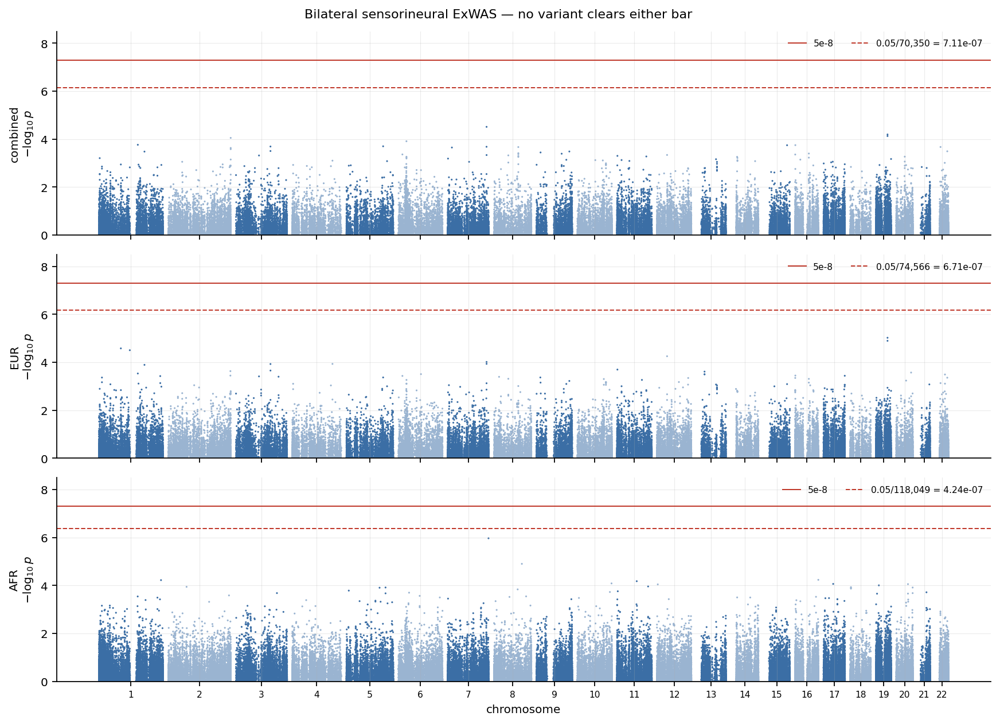
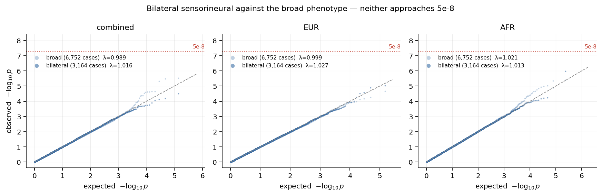
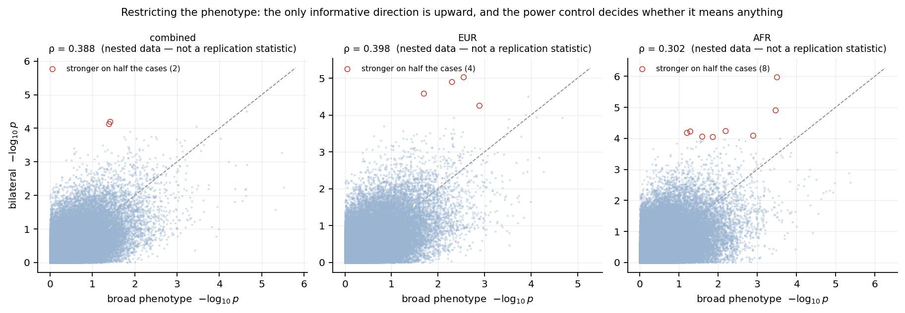
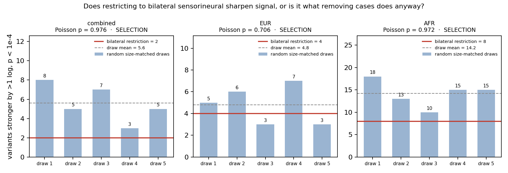
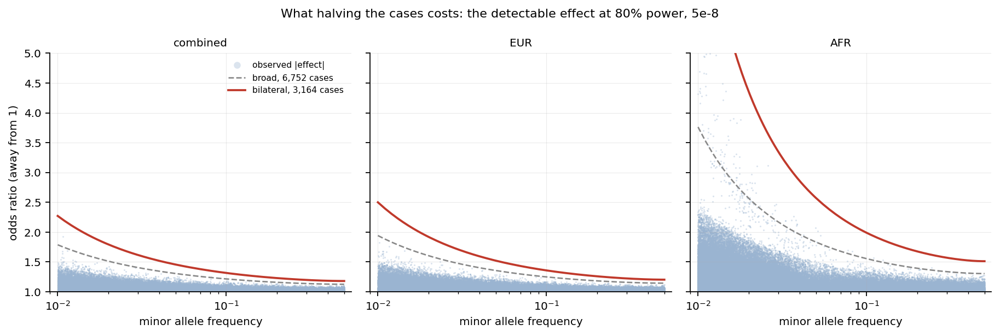

# Common-variant ExWAS, bilateral sensorineural — close-out

**Hall Lab × Epstein Lab · PMBB-Release-2026-4.0 · October 2026**
SAIGE single-variant · MAF ≥ 0.01 · 3,164 cases · 3 cohorts × 22 chromosomes

---

## Summary

This completes the 2×2:

| | broad phenotype | bilateral sensorineural |
|---|---|---|
| **rare-variant gene burden** (MAF ≤ 0.01) | `gene_burden_elena_replication/` | `gene_burden_pmbb_bilateral/` |
| **common-variant ExWAS** (MAF ≥ 0.01) | `exwas_elena_replication/` | **this document** |

Three things came out of it:

1. **Nothing is significant.** Minimum p is 3.08e-05 / 9.47e-06 / 1.07e-06 against a
   primary bar of 5e-8.
2. **A promising result appeared and was destroyed by its own control.** Two `BCAM`
   variants strengthened in two cohorts when the phenotype was restricted. A
   pre-registered test showed that random case removal produces *more* such variants
   than the real restriction does.
3. **At this cohort size the restriction cannot answer the question it was posed to
   answer** — in either direction. That is the arm's actual finding.

---

## The design fact that governs everything

The bilateral and broad cohorts are **nested**, verified rather than assumed:

- all **3,164** bilateral cases are also cases in the broad arm
- the **50,746** controls are the same individuals in both
- the restriction removes **3,588** cases and changes nothing else

So this is the broad analysis with cases deleted, and three things follow:

| | |
|---|---|
| **Agreement between the arms measures nothing** | it is the same data twice. Spearman ρ = 0.388 / 0.398 / 0.302, reported only to make explicit that it is not being used as a replication statistic. |
| **A variant getting weaker says nothing** | losing 53% of cases does that by itself, and "the association was not subtype-specific" cannot be separated from "we lost the power to see it". |
| **A variant getting stronger is the only informative direction** | removing cases removes information, so shared data cannot produce it. |

---

## Results

| cohort | tested | secondary bar | min p | hits at 5e-8 | hits at secondary |
|---|---:|---:|---:|---:|---:|
| combined | 70,350 | 7.11e-07 | 3.08e-05 | 0 | 0 |
| EUR | 74,566 | 6.71e-07 | 9.47e-06 | 0 | 0 |
| AFR | 118,049 | 4.24e-07 | 1.07e-06 | 0 | 0 |

λ = 1.016 / 1.027 / 1.013. Both bars were fixed before step 2 ran, at the same values
as the broad arm so that any difference between the two is a difference in phenotype
rather than in bookkeeping.

Note that **EUR and AFR both have a smaller minimum than the broad arm** — 9.47e-06
against 2.12e-05, and 1.07e-06 against 4.11e-06 — on half the cases. That is what
prompted the rest of this document.

---

## The result that did not survive

Applying "more than one log unit stronger than the broad arm, and p < 1e-4":

| cohort | count | notable |
|---|---:|---|
| combined | 2 | `chr19:44819634`, `chr19:44819705` — both `BCAM` |
| EUR | 4 | the same two `BCAM` variants, OR 1.17 → 1.35 |
| AFR | 8 | `chr7:158133844`, OR 1.80 → 2.90 |

`BCAM` — basal cell adhesion molecule, chr19q13.32, the Lutheran blood group — appeared
in two cohorts, with one missense and one synonymous variant 71 bp apart. On its face
this was the arm's most interesting output.

### The control

The counts are selected out of 70,000–118,000 comparisons per cohort. Remove half the
cases and every p-value moves; some move the lucky way. So the test is to hold the case
count fixed and remove the *phenotype*: draw 3,164 cases **at random** from the broad
arm's 6,752 and apply the identical criterion. Five draws per cohort, each needing its
own step 1 fit, for 15 null models and 330 step 2 jobs.

**The decision rule — including what would have counted as inconclusive — was written
into `phase_5/power_control/README.md` before any of it ran.**

| cohort | bilateral restriction | five random draws | draw mean | Poisson p | verdict |
|---|---:|---|---:|---:|---|
| combined | **2** | 8, 5, 7, 3, 5 | 5.6 | 0.976 | selection |
| EUR | **4** | 5, 6, 3, 7, 3 | 4.8 | 0.706 | selection |
| AFR | **8** | 18, 13, 10, 15, 15 | 14.2 | 0.972 | selection |

The rule fires on its first clause in all three cohorts, and **not marginally**: the
observed count is below the *mean* of the draws everywhere, and at or below every
individual draw in combined and AFR.

Removing 3,588 cases at random produces **more** apparent strengthening than removing
the 3,588 who lack bilateral sensorineural hearing loss. The restriction is slightly
less productive of it than chance.

`BCAM` is nothing. Without the control it would have been written up.

---

## Why the draws produce so many, and why AFR produces the most

Detectable odds ratio at 80% power, α = 5e-8:

| | cases | MAF 1% | MAF 5% | MAF 10% | MAF 50% |
|---|---:|---:|---:|---:|---:|
| bilateral combined | 3,164 | 2.27 | 1.45 | 1.31 | 1.18 |
| *broad combined* | *6,752* | *1.78* | *1.30* | *1.21* | *1.12* |
| bilateral EUR | 2,547 | 2.50 | 1.52 | 1.35 | 1.20 |
| bilateral AFR | **490** | **7.92** | 2.57 | 1.99 | 1.51 |

Common-variant effects on complex age-related traits sit at OR 1.05–1.15. This arm is
powered below that range almost everywhere.

**AFR's 490 cases make it uninformative for common variants** — OR 7.92 would be needed
at 1% frequency — and it is also the cohort whose random draws threw up the most
spurious strengthening (mean 14.2). Those are the same fact: where estimates are
noisiest, p-values wander furthest when the case set changes.

---

## What this arm does and does not conclude

**It does not conclude that bilateral sensorineural is the wrong phenotype.** The
clinical argument for it is unchanged: a narrower, more homogeneous case definition
should carry more genetic signal per case.

**It concludes that at 3,164 cases the restriction cannot demonstrate subtype
specificity in either direction**, because halving the cases introduces more noise than
any sharpening it produces. The question is not answered, and would not have been
answered even if the biology were favourable.

This is the second time this project has reached that conclusion by an independent
route. The burden arm's power control reached it through ClinGen gene enrichment; this
one reaches it through strengthening variants. Two different measurements, same answer:
**the limiting factor is the cohort, not the phenotype definition and not the method.**

---

## QC self-check

The test this project applied to the summer poster's hits, applied here:

| cohort | ρ (call rate vs −log₁₀p) | p | median call rate, top 100 | rest |
|---|---:|---:|---:|---:|
| combined | −0.0001 | 0.98 | 0.99984 | 0.99989 |
| EUR | −0.0034 | 0.35 | 0.99989 | 0.99990 |
| AFR | −0.0031 | 0.29 | 0.99981 | 0.99991 |

No relationship anywhere. A worse call rate buys no significance in this arm.

---

## Declared targets

`KNL1` and `ZFPM1` were pre-registered as targets (premise P7) before this arm ran. P7
was amended on 2026-10-09: the three variants behind the poster's claims are absent from
the genotypes and fail the poster's own call-rate filter — see the
[ExWAS replication close-out](../../exwas_elena_replication/confluence/exwas_replication_closeout.md).
There is no target here to hit or miss, and the second caveat in P7 holds regardless:
those genes were reported on the broad phenotype, so this arm could not have replicated
them even had they existed.

---

## Where the four arms now stand

| | broad | bilateral |
|---|---|---|
| **gene burden** | 0 significant · ClinGen enrichment p = 5.9e-6 | 0 significant · enrichment absent, shown by its power control to be lost power |
| **ExWAS** | 0 significant · replicates the delivered run at r = 0.99 · poster's hits fail their own QC | 0 significant · strengthening shown by its power control to be selection |

**No arm finds a gene or a variant.** The one positive result in the whole project
remains the ClinGen enrichment in the broad burden arm, and every attempt to sharpen the
phenotype has cost more in power than it gained in specificity.

Suggested next step for the group: a single synthesis page across all four arms, since
the useful statement is now about the set rather than about any one of them.

---

## Reproducibility

| | |
|---|---|
| `phase_2/scripts/` | MAF census — the bar denominators, fixed before step 2 |
| `phase_4/scripts/01_saige_step2.bsub` | 66 tasks, step 1 inherited from the burden arm |
| `phase_4/scripts/02_merge_results.py` | refuses on in-flight jobs, header drift, field counts, row counts outside the census bound, p-values outside (0,1] |
| `phase_5/scripts/01_calibration_and_crossarm.py` | verifies the nesting, then compares |
| `phase_5/power_control/` | the control, with its rule written first |
| `phase_5/power_control/scripts/04_readout.py` | refuses to issue a verdict on incomplete draws |
| `phase_5/scripts/02_power.py`, `03_qc_and_top_hits.py`, `04_figures.py` | the rest |

Premises in [`PREMISES.md`](../PREMISES.md). Findings in `phase_4/results/` and
`phase_5/results/`. Portuguese walk-throughs in `andre_notes/`.
