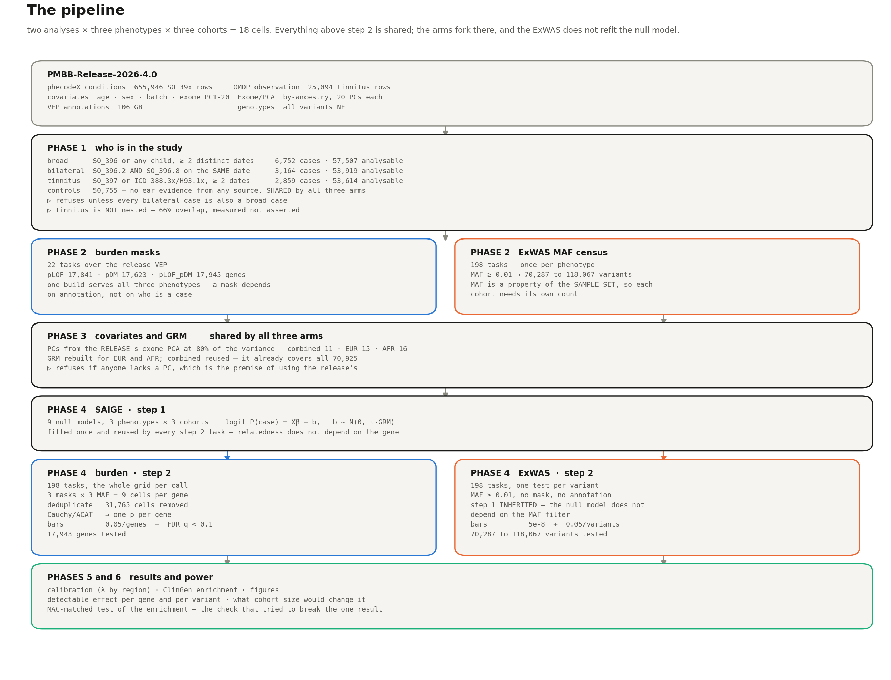

# The pipeline

**PMBB-Release-2026-4.0 · two analyses × three phenotypes × three cohorts = 18 cells**

Every number below is produced by the phase named beside it. Nothing is carried over
from an earlier run without being recomputed, except where a box says *inherited* and
says why.

---



*The same thing as ASCII below, for reading in a terminal.*

## The whole thing

```
  PMBB-Release-2026-4.0
  ├── Phenotype/4.0  conditions_phecode_x    655,946 SO_39x rows
  ├── Phenotype/4.0  observation              25,094 tinnitus rows
  ├── Phenotype/4.0  covariates               age · sex · batch · exome_PC1-20
  ├── Exome/PCA                               by-ancestry PCA, 20 PCs each
  ├── Exome/vep_annotations                   106 GB
  └── Exome/all_variants_NF                   genotypes
                    │
  ╔═════════════════▼══════════════════════════════════════════════════════╗
  ║ PHASE 1 — who is in the study                      01_cohorts.py       ║
  ║                                                                        ║
  ║   broad      SO_396 or any child, ≥ 2 distinct dates                   ║
  ║              6,752 cases · 57,507 analysable                           ║
  ║   bilateral  SO_396.2 AND SO_396.8 on the SAME date, ≥ 2 dates         ║
  ║              3,164 cases · 53,919 analysable                           ║
  ║   tinnitus   SO_397 or ICD 388.3x/H93.1x, ≥ 2 distinct dates           ║
  ║              2,859 cases · 53,614 analysable                           ║
  ║   controls   50,755 — no ear evidence from any source, SHARED          ║
  ║                                                                        ║
  ║   ⊳ refuses unless every bilateral case is also a broad case           ║
  ║   ⊳ tinnitus is NOT nested: 66% overlap, measured not asserted         ║
  ╚═══════════════════════════════╤════════════════════════════════════════╝
                                  │
            ┌─────────────────────┴─────────────────────┐
            │                                           │
  ╔═════════▼═══════════════════════╗       ╔═══════════▼════════════════════╗
  ║ PHASE 2 — burden masks          ║       ║ PHASE 2 — ExWAS MAF census     ║
  ║ 22 tasks, from release VEP      ║       ║ 198 tasks (3 phenotypes!)      ║
  ║                                 ║       ║                                ║
  ║   pLOF      17,841 genes        ║       ║   MAF ≥ 0.01 → ~70k-118k       ║
  ║   pDM       17,623              ║       ║   variants per cohort          ║
  ║   pLOF_pDM  17,945              ║       ║                                ║
  ║                                 ║       ║   MAF is a property of the     ║
  ║   one build serves both         ║       ║   SAMPLE SET, so the census    ║
  ║   phenotypes: masks depend on   ║       ║   runs once per phenotype      ║
  ║   annotation and genotypes,     ║       ║                                ║
  ║   not on who is a case          ║       ║   ⊳ histogram must sum to .bim ║
  ╚═════════════════╤═══════════════╝       ╚═══════════╤════════════════════╝
                    │                                   │
  ╔═════════════════▼═══════════════════════════════════▼══════════════════╗
  ║ PHASE 3 — covariates and GRM                   shared by both arms     ║
  ║                                                                        ║
  ║   PCs from the RELEASE's exome PCA, at 80% of the variance             ║
  ║     combined 11 (80.3%) · EUR 15 (83.3%) · AFR 16 (84.1%)              ║
  ║   GRM rebuilt for EUR and AFR; combined reused (covers all 70,925)     ║
  ║                                                                        ║
  ║   tested: 57,498 / 42,779 / 11,334  and  53,910 / 40,143 / 10,539      ║
  ║   ⊳ refuses if anyone lacks a PC — the premise of using the release's  ║
  ╚═══════════════════════════════╤════════════════════════════════════════╝
                                  │
  ╔═══════════════════════════════▼════════════════════════════════════════╗
  ║ PHASE 4 — SAIGE                                                        ║
  ║                                                                        ║
  ║   step 1   9 null models   logit P(case) = Xβ + b,  b ~ N(0, τ·GRM)    ║
  ║            3 phenotypes × 3 cohorts                                    ║
  ║            ╷                                                           ║
  ║            ├──────────────────────────┬────────────────────────────┐   ║
  ║            ▼                          ▼                            │   ║
  ║   BURDEN step 2                ExWAS step 2            INHERITED ──┘   ║
  ║   198 tasks, whole grid        198 tasks               the null model  ║
  ║   per call                                             does not depend ║
  ║   3 masks × 3 MAF = 9 cells    1 test per variant      on the MAF      ║
  ║   per gene                     MAF ≥ 0.01              filter          ║
  ║            │                          │                                ║
  ║   deduplicate ← 21,014 cells   (no combination needed)                 ║
  ║   Cauchy/ACAT → 1 p per gene                                           ║
  ║            │                          │                                ║
  ║   bars: 0.05/genes + FDR q<0.1  bars: 5e-8 + 0.05/variants             ║
  ║   17,943 genes                  70,366-118,049 variants                ║
  ╚═══════════════════════════════╤════════════════════════════════════════╝
                                  │
  ╔═══════════════════════════════▼════════════════════════════════════════╗
  ║ PHASE 5 — results           PHASE 6 — power                            ║
  ║   calibration (λ by region)   detectable effect per gene / per variant ║
  ║   ClinGen enrichment          what cohort size would change it         ║
  ║   figures                     MAC-matched test of the enrichment       ║
  ╚═══════════════════════════════╤════════════════════════════════════════╝
                                  │
                        SYNTHESIS — 24 cells, one figure
```

---

## Where the two arms share, and where they part

| | burden | ExWAS |
|---|---|---|
| cohorts (phase 1) | **shared** | **shared** |
| covariates and GRM (phase 3) | **shared** | **shared** |
| step 1 null models | fitted here | **inherited** — the null model does not depend on the MAF filter, which is what the original PMBB v4 run also did |
| variant selection | masks from VEP annotation | a MAF floor, no annotation |
| unit of testing | the gene | the variant |
| multiplicity within the unit | Cauchy/ACAT over 9 cells | none |
| bars | `0.05/genes` **and** FDR q < 0.10 | `5e-8` **and** `0.05/variants` |
| FDR | yes | **no** — a threshold over a count of tests we performed, while 5e-8 counts nothing we did |

---

## The three levels of multiplicity, and who pays for each

```
  SKAT-O's ρ sweep            SAIGE, internally
  the 9 cells of one gene     Cauchy/ACAT, in the merge
  the ~17,900 genes           Bonferroni and FDR
```

The nine cells are not nine hypotheses. They are nine ways of asking one question about
one gene, and the MAF cutoffs are nested — everything in 0.0001 is also in 0.001 and
0.01. Bonferroni across them would charge nine times for one question.

---

## Decisions, and why they went the way they did

| decision | why |
|---|---|
| **PCs from the release, not a PCA of our own** | the first pass re-ran a PCA to close a gap that did not exist: the original computed no PCA at all, its PCs are identical to the release's at `max\|diff\| = 0.00e+00`, and its `step7_ldprune.bsub` builds the **GRM**. A GRM step was read as a PCA step. |
| **but the GRM is still rebuilt** | that gap *is* real — 196 EUR and 34 AFR cohort members are absent from the original's pruned genotypes, and SAIGE would drop them silently |
| **80% of variance → 11/15/16 PCs** | the lab convention, stated 2026-10-14. This is the first run that meets it: the original reached 64/61/59%, the first pass 64/67/57% |
| **masks exclude non-coding genes** | `pLOF` presupposes a protein to lose. The original's set carries 651 antisense, 88 LINC and 14 microRNA genes; its top burden gene in two cohorts was `TMC3-AS1`, an antisense lncRNA |
| **`pDM` means "damaging AND not truncating"** | the group file carries one annotation per variant with pLOF taking precedence, so the 11,540 variants that are both enter pLOF only. A truncating variant is already tested by the arm that exists for truncation |
| **deduplicate before the ACAT** | SAIGE reruns a test when `pLOF:pDM` collapses onto one of its parts and does not notice. 21,014 cells across the six arms; it changes the omnibus in 424–875 genes per arm |
| **both bars, fixed before running** | a threshold chosen after seeing a p-value is not a threshold |
| **`--hwe` left as-is in the combined GRM** | fixing it would be a third difference from the original and would change every combined null model. A thin GRM corrects relatedness worse, which is the conservative direction. **First thing to redo if a combined result ever approaches a bar.** |

---

## What each phase refuses on

A check that only warns gets ignored. These stop the pipeline.

| phase | refuses when |
|---|---|
| 1 | a bilateral case is not also a broad case (the check is scoped to that pair — tinnitus overlaps rather than nests, and its overlap is measured instead) |
| 2 (masks) | a gene appears on two chromosomes · `pLOF_pDM` is not exactly the union · entry counts disagree with the manifest · LSF still has tasks in flight |
| 2 (census) | a histogram does not sum to its `.bim` |
| 3 | anyone in the cohort lacks a PC in the release |
| 4 (split) | any line is lost — the mask has two lines per gene and a naive split dropped every annotation line |
| 4 (merge) | headers differ between cells · field counts are wrong · row counts exceed the census ceiling or fall more than 0.5% short · p-values outside (0,1] · jobs in flight |
| 6 | a matched draw cannot be completed |

---

## Reproducing it

```
rare_variant/
  phase_1/scripts/00_extract_release_tables.sh     cache the phenotype extracts
  phase_1/scripts/01_cohorts.py                    all three phenotypes, one pass
  phase_2/scripts/01_build_masks.bsub              22 tasks
  phase_2/scripts/02_merge_masks.py
  phase_3/scripts/01_build_covariates.py           release PCs at 80%
  phase_3/scripts/02_build_grm.bsub                EUR and AFR
  phase_4/scripts/01_split_masks_by_chrom.sh
  phase_4/scripts/02_saige_step1.bsub              9 null models
  phase_4/scripts/03_saige_step2.bsub              198 tasks
  phase_4/scripts/04_merge_results.py              dedup → ACAT → both bars
  phase_5/scripts/01_fetch_clingen.py              stamps date + sha256
  phase_5/scripts/02_enrichment.py
  phase_5/scripts/03_figures.py
  phase_5/scripts/04_power.py
  phase_6/scripts/01_power_vs_clingen.py
  phase_6/scripts/02_matched_enrichment.py

exwas/
  phase_2/scripts/01_build_keep_lists.py           6 sample lists
  phase_2/scripts/02_maf_census.bsub               198 tasks
  phase_2/scripts/03_census_summary.py
  phase_4/scripts/01_saige_step2.bsub              198 tasks, step 1 inherited
  phase_4/scripts/02_merge_results.py
  phase_5/scripts/01_calibration.py                λ by region
  phase_5/scripts/02_figures.py
  phase_6/scripts/01_power.py

synthesis/
  scripts/01_collect.py                            18 of ours + 6 original
  scripts/02_figure.py
```

Each phase writes a `FINDINGS.md` beside its results. `synthesis/CONSOLIDATED.md` is the
one document to read first.
