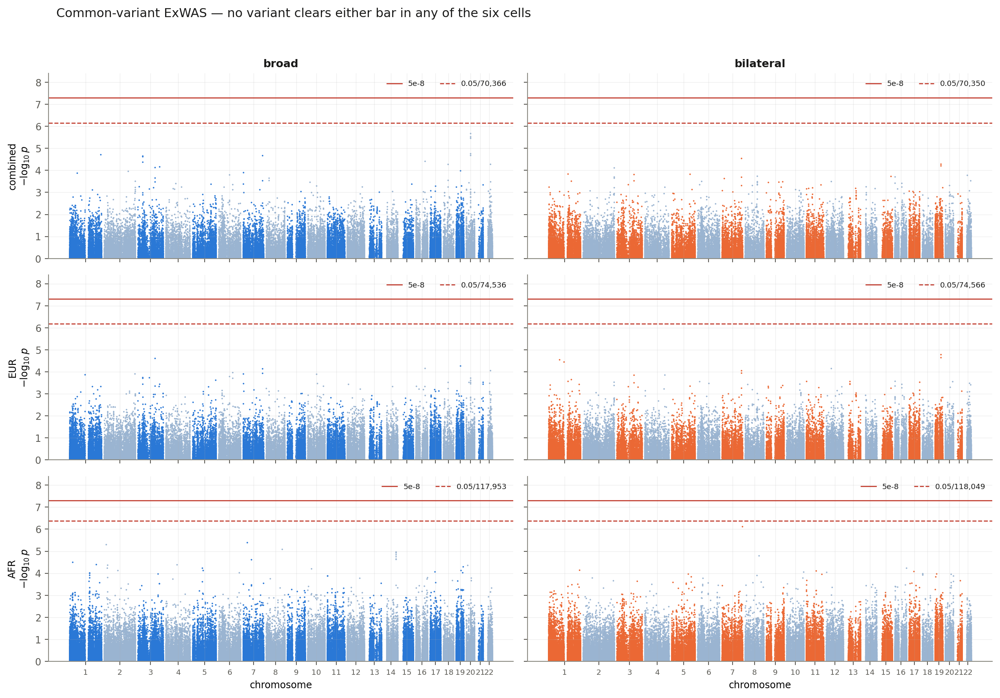
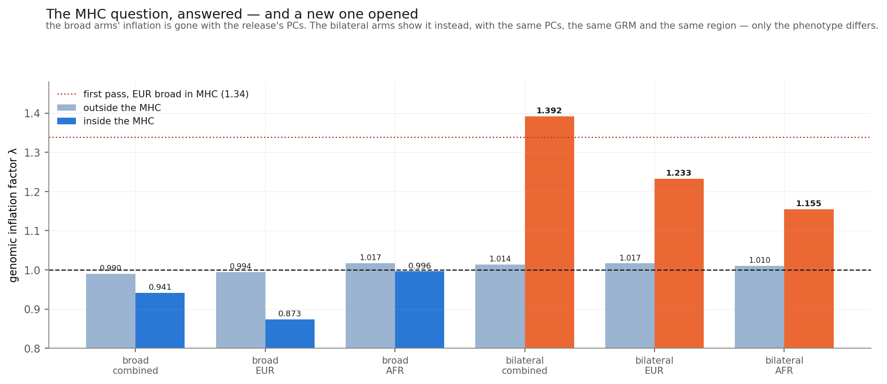

# ExWAS phase 5 — results and calibration

**Run 2026-10-14.** Step 2 job `49695978`, 132/132. Census job `49695969` plus two
retries. No step 1: the six null models are the burden arm's, reused because the null
model does not depend on the variant filter — which is what the original PMBB v4 run
also did.

## Nothing is significant, in any of the six cells

| phenotype | cohort | tested | secondary bar | min p | best variant | 5e-8 | secondary |
|---|---|---:|---:|---:|---|---:|---:|
| broad | combined | 70,366 | 7.11e-07 | 2.13e-06 | `20:33064486:G:A` | 0 | 0 |
| broad | EUR | 74,536 | 6.71e-07 | 2.47e-05 | `3:133755303:T:G` | 0 | 0 |
| broad | AFR | 117,953 | 4.24e-07 | 4.08e-06 | `7:31775671:C:G` | 0 | 0 |
| bilateral | combined | 70,350 | 7.11e-07 | 2.88e-05 | `7:150692505:T:C` | 0 | 0 |
| bilateral | EUR | 74,566 | 6.71e-07 | 1.66e-05 | `19:44819634:C:T` | 0 | 0 |
| bilateral | AFR | 118,049 | 4.24e-07 | **7.67e-07** | `7:158133844:C:T` | 0 | 0 |

`chr7:158133844` in bilateral AFR is **1.8× short of the secondary bar** — the closest
any ExWAS cell in this project has come. It is also one of the variants the first pass
flagged as strengthening under the bilateral restriction, and that pass's power control
showed the *count* of such variants is within what random size-matched case removal
produces. The count being uninformative does not make any individual one noise, but it
does mean this variant arrives already selected.

## The MHC question from the first pass, answered

| arm | λ outside MHC | λ inside MHC |
|---|---:|---:|
| broad combined | 0.990 | **0.941** |
| broad EUR | 0.994 | **0.873** |
| broad AFR | 1.017 | 0.996 |
| bilateral combined | 1.014 | **1.392** |
| bilateral EUR | 1.017 | **1.233** |
| bilateral AFR | 1.011 | 1.155 |

The first pass found λ = **1.3386** inside the MHC in the broad EUR arm, with 4 PCs of
its own PCA, against the original run's 0.97 with 9 release PCs — and could not tell
whether the cause was the count or the source.

**It was both, and it is fixed.** With 15 release PCs the same arm reads **0.873**:
from inflated to conservative. The hypothesis was right.

### And a new question the fix opened

The **bilateral** arms show the inflation the broad ones lost — 1.39, 1.23, 1.16 —
with the same PCs, the same GRM and the same region. Only the phenotype differs.

Two readings, and this cannot separate them:

- **noise.** 3,164 cases against 6,752, and λ is estimated on ~1,020 variants. All three
  bilateral arms rise together, which looks like a sample-size effect rather than
  anything specific to the region.
- **real.** The MHC carries the immune genes, and bilateral sensorineural hearing loss
  has recognised autoimmune causes. Case structure there could exist and be diluted by
  the broad phenotype.

The first is much more likely. It is recorded because it is the first time the MHC has
behaved differently between the two phenotypes with everything else held fixed, and
because a λ of 1.39 on 1,023 variants in an arm where the minimum p is 2.88e-05 changes
no conclusion either way.

## Lambda is legitimate here, unlike in the burden arm

The genomic inflation factor assumes a null statistic that is chi-square on 1 df, which
is exactly what a single-variant score test produces. The burden arm's omnibus is
Cauchy-combined, which deflates λ to 0.68–0.84 throughout and makes it useless as a
readout there. This arm needs no such caveat.

The exact `qchisq(0.5, 1) = 0.4549364` is used, not the 0.456 rounded in the original
run's `step10_1_QQplot.R`, which inflates λ by 0.23%.

## Broad against bilateral: what the comparison can and cannot say

| cohort | shared variants | Spearman ρ | stronger on half the cases |
|---|---:|---:|---:|
| combined | 70,269 | 0.386 | 2 |
| EUR | 74,451 | 0.399 | 4 |
| AFR | 117,360 | 0.304 | 7 |

**ρ is reported only to make explicit that it is not a replication statistic.** The arms
share every control and the bilateral cases are a strict subset of the broad ones, so
agreement between them is the same data twice. A variant getting weaker says nothing
either — losing 53% of cases does that by itself.

Only strengthening could be informative, and the first pass tested it: five random
size-matched draws produced means of 5.6, 4.8 and 14.2 strengthening variants against
the restriction's 2, 4 and 8. Random case removal produces *more* than the real
restriction does.

## Both bars, fixed before the run

| | |
|---|---|
| primary, **5e-8** | the convention, and the threshold the summer poster used |
| secondary, **0.05 / tested** | Bonferroni over what we actually ran, ~7e-07 |

The primary is about ten times stricter, because it was calibrated for genome-wide
testing and this is exome-only.

**No FDR.** That was explicit on 2026-10-14 — *"you do not do FDR for ExWAS"* — and the
split is principled: FDR is a threshold over a count of tests we performed, while 5e-8
counts nothing we did.

## Files

| | |
|---|---|
| `phase_4/results/merged_<arm>.tsv` | one row per tested variant |
| `phase_4/results/02_merge.json` | per-arm counts, bars, and the census reconciliation |
| `results/01_calibration.json` | λ by region, cross-phenotype comparison |
| `figures/manhattan.png`, `figures/lambda_mhc.png` | |
