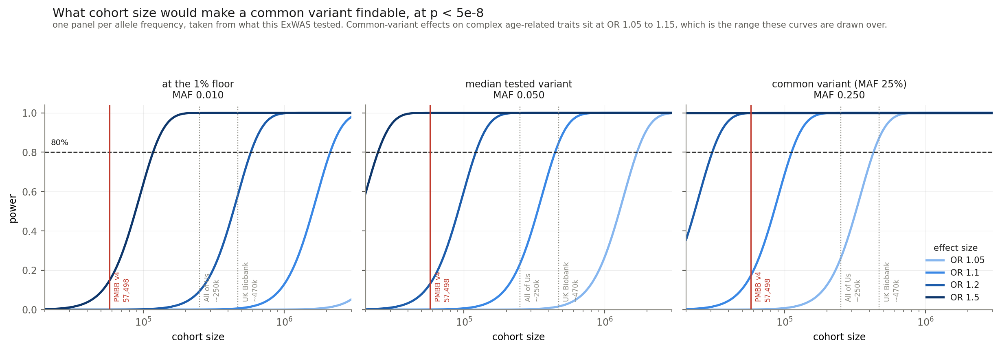

# ExWAS phase 6 — power

**Run 2026-10-14; prevalence extended to three phenotypes 2026-10-15.**

Cohort size needed for 80% power at p < 5e-8:

| | OR 1.05 | OR 1.1 | OR 1.2 | OR 1.5 |
|---|---:|---:|---:|---:|
| at the 1% floor | 8.1M | 2.1M | 581k | 117k |
| median tested variant (MAF 0.050) | 1.7M | 444k | 121k | 25k |
| common variant (MAF 0.25) | 428k | 112k | 31k | 6k |

This cohort is **57,498**.

### Prevalence is not shared across the arms, and it drives the answer

Information goes as `phi(1-phi)`, so a rarer phenotype needs a bigger cohort for the
same variant at the same effect. Tinnitus at 5.3% cases carries 0.0505 against broad
hearing loss's 0.1035 — **a factor of 2.05 in required cohort size**, not a rounding
difference. At the median tested variant and OR 1.1:

| phenotype | cases | prevalence | cohort needed |
|---|---:|---:|---:|
| broad | 6,752 | 11.7% | 444k |
| bilateral | 3,164 | 5.9% | 833k |
| tinnitus | 2,859 | 5.3% | 912k |

The arms as run are 57,498 / 53,910 / 53,605. The full table at all three prevalences
is in `04_power.json`.

This is the number to carry into any replication proposal: **a cohort sized for the
broad phenotype is half the size it needs to be for tinnitus.**

## Why the null, in one line

**Common-variant effects on complex, age-related traits sit at OR 1.05–1.15.** At the
median tested frequency this cohort would need 444,000 people to see OR 1.1, and 1.7
million to see OR 1.05. It has 57,498.

So the honest reading is *"no common-variant effect larger than this cohort could see"*,
and the cohort can see very little: at the median frequency it is powered only from
about OR 1.5 upward, which is far above where common-variant effects live.

## How this differs from the burden arm's power analysis

The two cannot share a figure and the numbers are not comparable.

| | burden | ExWAS |
|---|---|---|
| unit | the gene | the variant |
| parameterised by | cumulative carrier count across the mask | one allele's frequency |
| range in our data | MAC 1 to 26,793 — four orders of magnitude | MAF 0.01 to 0.5, by construction |
| optimism correction needed | **yes** — assumes every masked variant is causal | **no** — no mask, no causal fraction assumed |
| effect sizes that matter | OR 2–5 (truncating variants, when they matter, matter a lot) | OR 1.05–1.15 |

The burden arm has a long tail of genes that cannot be tested at all — the median gene
carries five rare alleles among the cases. The ExWAS has no such tail: everything tested
is above 1% by construction, so the limit is purely effect size against cohort size.

## What this says about replication elsewhere

A cohort at All of Us's scale (~250k) would reach **OR 1.2** at the median tested
frequency and **OR 1.1** for common variants. UK Biobank's (~470k) would reach about
OR 1.1 at the median.

Neither reaches OR 1.05 at the median, which would need 1.7 million.

*Biobank figures are approximate and drawn to show scale. Confirm before quoting.*

**But the burden arm is the better use of a larger cohort**, and this is the number that
says so. The first pass measured how close each approach gets to its own bar: burden
1.9–25× short, ExWAS 21–616×. Rare-variant work lands an order of magnitude closer, and
that preference matches the biological judgement the group already held.

## Files

| | |
|---|---|
| `results/04_power.json` | the curves and the required cohort sizes |
| `figures/power.png` | |
