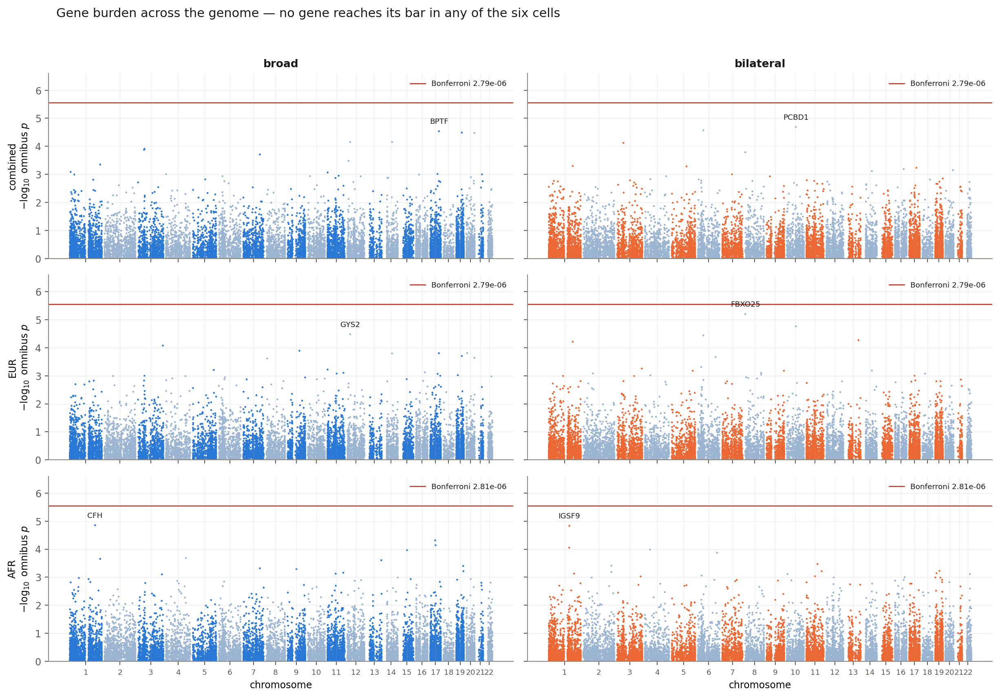
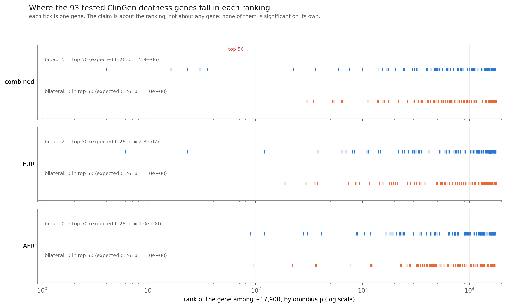
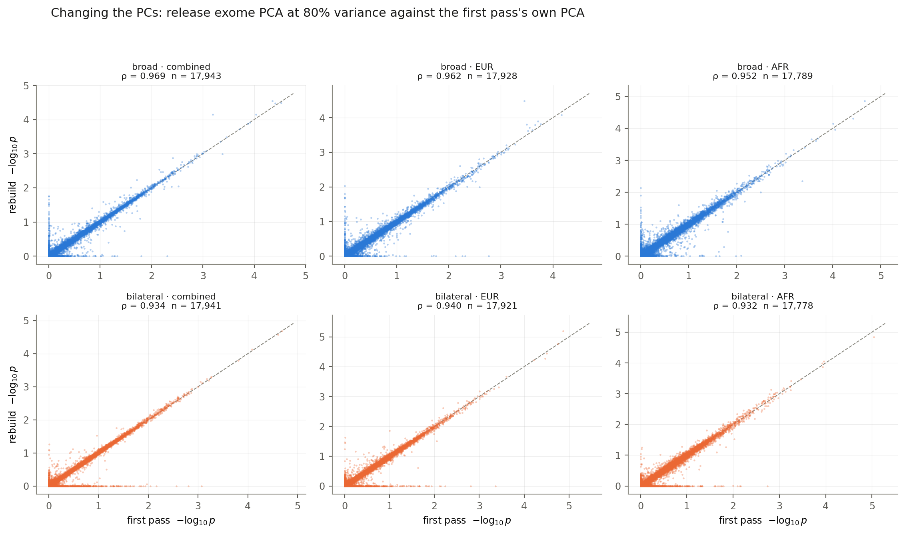

# Phase 5 — results

**Run 2026-10-14.** ClinGen list fetched fresh; sha256
`67b27ac88081d4e3e566454da7f930d6ee579e6db8a7b561f818da76675ee0df`, 167 gene-disease
pairs, 100 at Definitive or Strong — identical to the list the first pass used, so the
comparison below is clean.

## Nothing is significant

| phenotype | cohort | min omnibus p | best gene | Bonferroni | min q | FDR |
|---|---|---:|---|---:|---:|---:|
| broad | combined | 2.88e-05 | `BPTF` | 0 | 0.1984 | 0 |
| broad | EUR | 3.31e-05 | `GYS2` | 0 | 0.4770 | 0 |
| broad | AFR | 1.40e-05 | `CFH` | 0 | 0.2482 | 0 |
| bilateral | combined | 2.06e-05 | `PCBD1` | 0 | 0.2394 | 0 |
| bilateral | EUR | **6.33e-06** | **`FBXO25`** | 0 | **0.1134** | 0 |
| bilateral | AFR | 1.46e-05 | `IGSF9` | 0 | 0.2593 | 0 |

## The one positive result survived the rebuild unchanged

Known deafness genes cluster at the top of the broad combined ranking far more than
chance allows:

| arm | ClinGen in top 50 | expected | p |
|---|---:|---:|---:|
| **broad combined** | **5** | 0.26 | **5.91e-06** |
| broad EUR | 2 | 0.26 | 2.78e-02 |
| broad AFR | 0 | 0.26 | 1.00 |
| bilateral, all three | 0 | 0.26 | 1.00 |

The five are `SIX1`, `GJB3`, `COCH`, `TMPRSS3`, `MYO6`.

**Identical to the first pass, to the digit, in all six arms and with the same five
genes.** That matters more than it looks. Between the two runs we changed the PCA source
from one of our own to the release's, raised the PC counts from 5/4/3 to 11/15/16, and
added deduplication before the combination. None of it moved the project's only positive
finding.

At the looser Definitive+Strong+Moderate tier it is stronger still: 6 of the top 50
against 0.31 expected, p = 6.57e-07.

**What this says and does not say.** It is a statement about the ranking, not about any
gene — none of the five is significant on its own. The pipeline is finding real biology
that sits below the detection floor. It does not license naming any of them as a result.

## What changing the PCs did

Spearman ρ between the rebuild's omnibus and the first pass's, per gene:

| | combined | EUR | AFR |
|---|---:|---:|---:|
| broad | 0.969 | 0.962 | 0.952 |
| bilateral | 0.934 | 0.940 | 0.932 |

Individual p-values move; the ordering largely does not. Given that the EUR arm went
from 4 PCs of our own PCA to 15 of the release's — a different PCA, not merely more of
the same one — ρ ≈ 0.94–0.96 is a reassuring amount of stability rather than a
disappointing lack of change.

## `FBXO25` is the only thing worth watching

Bilateral EUR, q = 0.1134 against a 0.10 bar — **short by 13%**, and 2.3× short of
Bonferroni.

It was also the top gene of the same arm in the first pass, at 1.37e-05. Under the
release's 15 PCs it moved to **6.33e-06**: it **strengthened** when ancestry correction
improved. That is the direction a real signal moves and the opposite of what residual
stratification would do.

It is not a result. It is the first thing in this project that merits being looked at
again, and the honest framing for a meeting is "the closest anything has come, and it
got closer when we corrected better", not "a candidate gene".

## Why the bilateral arms find nothing, and what that does not mean

Zero ClinGen genes in the top 50 of any bilateral arm, against 5 and 2 in the broad ones.

The first pass tested this directly rather than assuming: five random size-matched draws
from the broad cases produced 2, 0, 1, 2, 3 ClinGen genes in their top 50 — pooled
8/250 against 1.3 expected, p = 6.4e-05. **Restricting the phenotype costs what removing
the same number of cases at random costs.** The signal was not destroyed by the
restriction; the power was.

That control was run on the first pass's data and is not repeated here. It would be, if
anything in a bilateral arm approached a bar.

## Files

| | |
|---|---|
| `results/02_enrichment.json` | counts, expectations and p at three depths, two tiers, six arms |
| `data/clingen_hl_genes.tsv` | the list, with its manifest and sha256 |
| `figures/manhattan.png` | all six cells, Bonferroni drawn |
| `figures/clingen.png` | where each tested ClinGen gene ranks |
| `figures/vs_first_pass.png` | the effect of the PC change |
