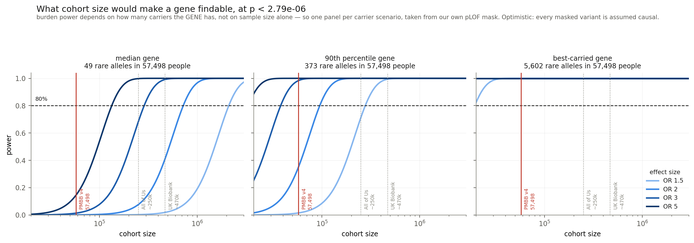

# Phase 6 — power, and whether the one positive result survives it

**Run 2026-10-14; extended to the tinnitus arm and corrected 2026-10-15.** Opened because phase 5 left two things sitting oddly together:
nothing is significant anywhere, and known deafness genes cluster at the top of the
broad combined ranking at p = 5.9e-06.

## Why nothing is significant: there is almost nothing to test

The carrier count per gene, from the `pLOF` mask at MAF ≤ 0.01 in the broad combined
cohort:

| percentile | distinct variants | MAC | MAC in cases |
|---:|---:|---:|---:|
| 25 | 9 | 18 | 2 |
| **50** | **17** | **49** | **5** |
| 75 | 29 | 139 | 16 |
| 90 | 45 | 373 | 44 |
| max | — | 5,602 | 641 |

**64% of genes carry fewer than 10 rare alleles among the 6,752 cases. 91% carry fewer
than 50.** The median gene has 17 distinct variants summing to 49 alleles across 57,498
people — about 2.5 carriers per variant, and 5 of them cases.

A burden test on five case carriers cannot detect anything, whatever the true effect is.

### What cohort size would change that

Cohort needed for 80% power at p < 2.79e-06:

| | OR 1.5 | OR 2 | OR 3 | OR 5 |
|---|---:|---:|---:|---:|
| median gene (MAC 49) | 2.1M | 720k | 287k | 134k |
| 90th percentile (MAC 373) | 277k | 95k | 38k | 18k |
| best-carried (MAC 5,602) | 19k | 7k | 3k | 1k |

This cohort is 57,498. **For the median gene it is not powered even at OR 5.**

For replication elsewhere: a cohort near All of Us's scale would reach OR 3 on the
median gene and most effects on well-covered ones; UK Biobank's would approach OR 2.
Neither reaches OR 1.5 on a median gene, which would need roughly two million.

*The biobank figures are approximate and are drawn to show scale. Confirm before quoting
either.*

The model treats each gene as one super-variant at its observed cumulative frequency and
assumes every masked variant is causal. Real masks contain neutral variants that dilute
the signal, so the true requirement is **larger** than these numbers. Optimistic on
purpose: it makes a null harder to explain away, not easier.

### A correction to the bilateral and tinnitus figures

The cohort sizes were hardcoded at the **broad** arm's values and reused for the other
phenotypes, giving bilateral 57,498 people when its model was fitted on 53,910. Each
phenotype excludes a different set of "other ear" patients, so every arm has its own N.
The script now reads N and the case count from phase 3, which records what SAIGE was
actually given.

**The error was conservative, not optimistic.** Information goes as `mac · phi(1-phi)`
with `phi = cases/n`, so an inflated N dilutes the case fraction and makes the arm look
*less* powered than it is. Bilateral combined: detectable OR reported at 3.20, actual
3.10. No conclusion moves, and the direction is the safe one.

### Coverage and detectable effect, all nine arms

| arm | ClinGen median MAC | other genes | detectable OR, ClinGen | ClinGen genes findable at OR 3 |
|---|---:|---:|---:|---:|
| broad combined | 453 | 190 | 2.24 | 69 of 93 |
| broad EUR | 251 | 107 | 2.92 | 52 of 93 |
| broad AFR | 75 | 38 | 7.51 | 22 of 93 |
| bilateral combined | 435 | 178 | 3.10 | 45 of 93 |
| bilateral EUR | 235 | 101 | 4.40 | 28 of 93 |
| bilateral AFR | 72 | 36 | 22.16 | 8 of 93 |
| tinnitus combined | 431 | 177 | 3.28 | 39 of 93 |
| tinnitus EUR | 235 | 100 | 4.97 | 28 of 93 |
| tinnitus AFR | 71 | 36 | 17.56 | 9 of 93 |

ClinGen genes are better covered than average in every arm (Mann-Whitney p < 0.001
throughout) — which is the fact the matched test below exists to control for.

## The uncomfortable finding, and the test that resolved it

ClinGen Definitive/Strong genes are **substantially better covered** than the average
gene, in every arm:

| arm | ClinGen median MAC | others | Mann-Whitney p | ClinGen powered for OR 3 | others |
|---|---:|---:|---:|---:|---:|
| broad combined | 453 | 190 | <0.001 | 69 of 93 | 42.7% |
| broad EUR | 251 | 107 | <0.001 | 52 of 93 | 27.5% |
| broad AFR | 75 | 38 | <0.001 | 22 of 93 | 7.1% |
| bilateral combined | 435 | 178 | <0.001 | 43 of 93 | 22.3% |
| bilateral EUR | 235 | 101 | <0.001 | 28 of 93 | 12.5% |
| bilateral AFR | 72 | 36 | <0.001 | 8 of 93 | 0.6% |

More than double the carriers. In retrospect this is unsurprising — well-studied genes
tend to be larger and more variable, which is part of why they were found — but it
raises a specific doubt about phase 5's positive result: **is the enrichment measuring
biology, or measuring where the power happens to be?**

### Check 1 — calibration. Suggestive, not decisive.

Under the null a p-value is uniform whatever the power, so coverage should not shift
rank at all. Across MAC sextiles in the broad combined arm:

| MAC range | median p | fraction p < 0.05 |
|---|---:|---:|
| 1–54 | 0.522 | 0.041 |
| 55–107 | 0.559 | 0.042 |
| 108–191 | 0.569 | 0.054 |
| 192–341 | 0.588 | 0.051 |
| 342–674 | 0.599 | 0.052 |
| 675–26,793 | 0.643 | 0.048 |

The tail is flat at ~0.05 everywhere, and the median **rises** with MAC — conservativeness
at high coverage, the opposite of the bias being looked for. So nothing in the tail,
which is what ranks 1–50 depend on, favours well-covered genes.

### Check 2 — hold coverage fixed. This one decides it.

Draw 93 non-ClinGen genes matched to the ClinGen set on log₁₀ MAC (window 0.10, a factor
of 1.26), count how many land in the top 50, repeat 2,000 times.

| arm | observed | matched draws: mean | max | distribution | empirical p |
|---|---:|---:|---:|---|---:|
| broad combined | **5** | 0.20 | 3 | 0 in 1,641 · 1 in 324 · 2 in 33 · 3 in 2 | **< 0.0005** |
| broad EUR | **2** | 0.24 | 3 | 0 in 1,573 · 1 in 383 · 2 in 39 · 3 in 5 | **0.0220** |

**Not one of 2,000 coverage-matched draws reached 5.** The enrichment survives matching
intact.

Scoped to the two arms with any ClinGen gene in the top 50; the other four have zero, so
there is nothing for a matched draw to beat.

## What this means

Phase 5's positive result is **stronger** after this phase, not weaker. The obvious
alternative explanation was tested directly and failed: the ranking is not picking out
ClinGen genes because they are easier to find.

And the two findings now fit together rather than sitting oddly:

> The study is not powered to detect any individual gene — the median one carries five
> rare alleles among the cases — yet known deafness genes still rise to the top of the
> ranking, and they do so beyond what their better coverage explains.

That is what real signal below a detection floor looks like. It remains a statement about
the ranking: none of `SIX1`, `GJB3`, `COCH`, `TMPRSS3` or `MYO6` is significant on its own,
and none may be named as a finding.

**The matched test is run only on the two arms that have something to explain away.**
Bilateral and tinnitus put zero ClinGen genes in the top 50 of every cohort, and a
matched null for an observed count of zero answers nothing — running it there would
manufacture three more p-values of 1.0.

## Files

| | |
|---|---|
| `results/gene_power.tsv` | per gene per arm: MAC, detectable OR, ClinGen membership |
| `results/01_power_vs_clingen.json` | the coverage comparison |
| `results/02_matched_enrichment.json` | the matched draws |
| `../phase_5/figures/power.png` | power against cohort size |
