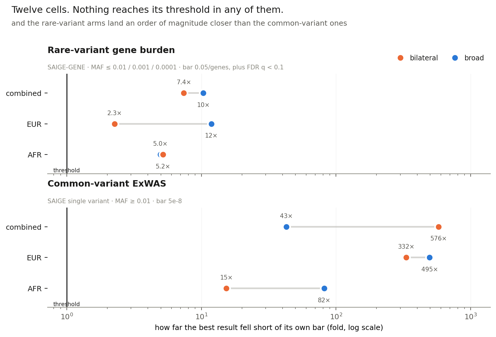

# Hearing loss in PMBB v4 — the rebuilt analysis, consolidated

**Hall Lab × Epstein Lab · PMBB-Release-2026-4.0 · October 2026**
Every number here is read from the file the phase that produced it wrote;
`scripts/01_collect.py` assembles it.

---

## The headline

**Twelve cells — two methods × two phenotypes × three cohorts. Nothing reaches its
threshold in any of them.** The closest is 2.3× short; the furthest is 576×.

The second thing the figure says is the useful one: **the rare-variant arms land an
order of magnitude closer than the common-variant ones** — burden 2.3–12×, ExWAS
15–576×.

---

## What was run

| | broad phenotype | bilateral sensorineural |
|---|---|---|
| **rare-variant gene burden** | 6,752 cases | 3,164 cases |
| **common-variant ExWAS** | the same cohorts, MAF ≥ 0.01 | |

Both phenotypes are built by one script, so the control set is shared by construction
and **every bilateral case is also a broad case** — asserted in code, not assumed.

| cohort | broad: analysable / tested / cases | bilateral: analysable / tested / cases |
|---|---|---|
| combined | 57,507 / 57,498 / 6,752 | 53,919 / 53,910 / 3,164 |
| EUR | 42,786 / 42,779 / 5,183 | 40,150 / 40,143 / 2,547 |
| AFR | 11,334 / 11,334 / 1,285 | 10,539 / 10,539 / 490 |

*Analysable* is what the phenotype supports; *tested* is what reached SAIGE after
covariates. The difference is 9 and 7 people with no `AGE`, **all of them controls**, so
no case is lost anywhere.

---

## Results

### Rare-variant gene burden

Bar: `0.05 / genes`. FDR (Benjamini-Hochberg, q < 0.10) reported alongside, as asked on
2026-10-14.

| phenotype | cohort | genes | min omnibus p | best gene | short by | min q | hits |
|---|---|---:|---:|---|---:|---:|---:|
| broad | combined | 17,943 | 2.88e-05 | `BPTF` | 10.3× | 0.198 | 0 |
| broad | EUR | 17,928 | 3.31e-05 | `GYS2` | 11.9× | 0.477 | 0 |
| broad | AFR | 17,789 | 1.40e-05 | `CFH` | 5.0× | 0.248 | 0 |
| bilateral | combined | 17,941 | 2.06e-05 | `PCBD1` | 7.4× | 0.239 | 0 |
| **bilateral** | **EUR** | 17,921 | **6.33e-06** | **`FBXO25`** | **2.3×** | **0.113** | 0 |
| bilateral | AFR | 17,778 | 1.46e-05 | `IGSF9` | 5.2× | 0.259 | 0 |

### Common-variant ExWAS

Bars: `5e-8` (primary, the convention) and `0.05 / variants` (secondary, ~7e-07). No
FDR — that was explicit, and the split is principled: FDR is a threshold over a count of
tests we performed, while 5e-8 counts nothing we did.

| phenotype | cohort | variants | min p | best variant | short of 5e-8 |
|---|---|---:|---:|---|---:|
| broad | combined | 70,366 | 2.13e-06 | `20:33064486:G:A` | 43× |
| broad | EUR | 74,536 | 2.47e-05 | `3:133755303:T:G` | 495× |
| broad | AFR | 117,953 | 4.08e-06 | `7:31775671:C:G` | 82× |
| bilateral | combined | 70,350 | 2.88e-05 | `7:150692505:T:C` | 576× |
| bilateral | EUR | 74,566 | 1.66e-05 | `19:44819634:C:T` | 332× |
| **bilateral** | **AFR** | 118,049 | **7.67e-07** | `7:158133844:C:T` | 15× |

---

## The one positive result, and the test that nearly undid it

Known deafness genes cluster at the top of the burden rankings far more than chance
allows:

| arm | ClinGen Definitive/Strong in top 50 | expected | p |
|---|---:|---:|---:|
| **broad combined** | **5** | 0.26 | **5.91e-06** |
| broad EUR | 2 | 0.26 | 2.78e-02 |
| everything else | 0 | 0.26 | 1.00 |

The five are `SIX1`, `GJB3`, `COCH`, `TMPRSS3`, `MYO6`.

**Identical to the first pass, to the digit, with the same five genes** — after changing
the PCA source, raising the PC counts from 5/4/3 to 11/15/16, and adding deduplication
before the combination.

### The threat, and how it was resolved

ClinGen genes turn out to be **substantially better covered** than the average gene:
median MAC 453 against 190 in the broad combined arm, Mann-Whitney p < 0.001 in all six.
Well-studied genes tend to be larger and more variable, which is part of why they were
found. So the enrichment might have been measuring coverage rather than biology.

Two checks. Calibration is suggestive: across MAC sextiles the fraction of p below 0.05
is flat at ~0.05, and the *median* p rises with coverage — the opposite of the bias in
question. **The decisive test holds coverage fixed:**

| arm | observed | 2,000 MAC-matched draws: mean | max | empirical p |
|---|---:|---:|---:|---:|
| broad combined | **5** | 0.20 | 3 | **< 0.0005** |
| broad EUR | **2** | 0.24 | 3 | **0.0220** |

**Not one of 2,000 coverage-matched draws reached 5.** The enrichment survives intact.

It remains a statement about the **ranking**. None of the five is significant on its
own, and none may be named as a finding.

---

## Why nothing is significant

### The burden arm has almost nothing to test

| percentile | distinct variants | MAC | MAC in cases |
|---:|---:|---:|---:|
| 50 | 17 | 49 | **5** |
| 90 | 45 | 373 | 44 |

**64% of genes carry fewer than ten rare alleles among the 6,752 cases.** A burden test
on five case carriers cannot detect anything whatever the true effect.

Cohort needed for 80% power at `0.05/genes`:

| | OR 1.5 | OR 3 | OR 5 |
|---|---:|---:|---:|
| median gene | 2.1M | 287k | 134k |
| 90th percentile gene | 277k | 38k | 18k |

This cohort is 57,498. **For the median gene it is not powered even at OR 5.**

### The ExWAS is limited by effect size, not coverage

Everything it tests is above 1% by construction, so there is no untestable tail. Cohort
needed at `5e-8`:

| | OR 1.05 | OR 1.1 | OR 1.2 |
|---|---:|---:|---:|
| median tested variant (MAF 0.050) | 1.7M | 444k | 121k |
| common variant (MAF 0.25) | 428k | 112k | 31k |

Common-variant effects on complex age-related traits sit at **OR 1.05–1.15**. At the
median frequency this cohort would need 444,000 people to see OR 1.1.

### And the sharpest statement the project can make

In the four well-covered ClinGen genes — `GJB3`, `COCH`, `MYO6`, `TMPRSS3` — this study
**would have detected OR ≥ 1.7 and did not.** So if their effect exists in this
population, it is smaller than that: real but modest, consistent with polygenic risk in
adult-onset hearing loss rather than the Mendelian effects that put them on the panel.

`SIX1` is the exception worth noting: MAC 87, detectable only from OR 6.31, and still
the **4th gene** in the whole ranking.

---

## What a replication elsewhere would buy

Cohort needed to detect each effect in the four well-covered ClinGen genes:

| | OR 1.5 | OR 1.3 | OR 1.2 |
|---|---:|---:|---:|
| `GJB3` | 100k | **239k** | 494k |
| `COCH` | 108k | **258k** | 534k |
| `MYO6` | 115k | 274k | 568k |
| `TMPRSS3` | 119k | 285k | 591k |

A cohort at **All of Us's scale (~250k) lands exactly where OR 1.3 becomes visible** in
all four. UK Biobank's (~470k) approaches OR 1.2.

We already know the effect is **below 1.7**. Whether it is above 1.2 or 1.3 is what a
larger cohort would settle, and 250k sits in the middle of the plausible range.

Three honest caveats:

| | |
|---|---|
| `SIX1` is not rescued | 87 alleles; it would need 1.2M for OR 1.5 |
| the phenotype must be comparable | our prevalence is 11.7% on phecodeX with a two-date rule. **This has not been checked for either biobank and is the first thing to confirm.** |
| the power model is optimistic | it assumes every masked variant is causal, so real requirements are larger |

*Biobank figures are approximate and drawn to show scale.*

---

## What changed in the rebuild, and what it cost

| | |
|---|---|
| **PCs from the release**, at 80% variance (11/15/16) | the first pass re-ran a PCA to close a gap that did not exist — the original computed no PCA at all, its PCs are identical to the release's at `max\|difference\| = 0.00e+00`, and its `step7_ldprune.bsub` builds the GRM. A GRM step was read as a PCA step. |
| **GRM still rebuilt** for EUR and AFR | that gap is real: 196 and 34 cohort members are absent from the original's pruned genotypes |
| **Deduplication before the combination** | raised by Nikki Palmiero. Removes 1,542–6,911 cells per arm and changes the omnibus in 424–875 genes |
| **FDR alongside Bonferroni**, burden only | asked for on 2026-10-14; nothing clears q < 0.1, best is 0.113 |

**The MHC question is answered.** The first pass found λ = 1.3386 inside the MHC in broad
EUR with 4 PCs of its own PCA. With 15 release PCs the same arm reads **0.873** — from
inflated to conservative.

And it opened a new one: the **bilateral** arms now show that inflation (1.39, 1.23,
1.16) with the same PCs, GRM and region — only the phenotype differs. Most likely noise
at 3,164 cases on ~1,020 variants, but the first time the MHC has behaved differently
between the phenotypes with everything else fixed.

---

## What the set says

1. **Nothing is significant anywhere**, under any phenotype, either method, any cohort,
   against either of that cell's bars.
2. **The pipeline works.** Known deafness genes cluster at p = 5.9e-06, and that survives
   a test designed to break it.
3. **The limiting factor is the cohort.** The median gene carries five rare alleles among
   the cases.
4. **Rare-variant work is the better use of a larger cohort**, by an order of magnitude
   in how close it gets.
5. **The experiment that would answer the question is now specified**: ~250k people with
   comparable phenotyping resolves OR 1.3 in four known deafness genes.

### Next

| | |
|---|---|
| confirm phenotype comparability in All of Us / UK Biobank | the one thing that could invalidate the plan above |
| more cases, not more methods | every cell is power-limited; another analysis of the same 6,752 will not change it |
| revisit the combined GRM if a combined result ever approaches a bar | `--hwe` across ancestries leaves it thinner than EUR alone |
