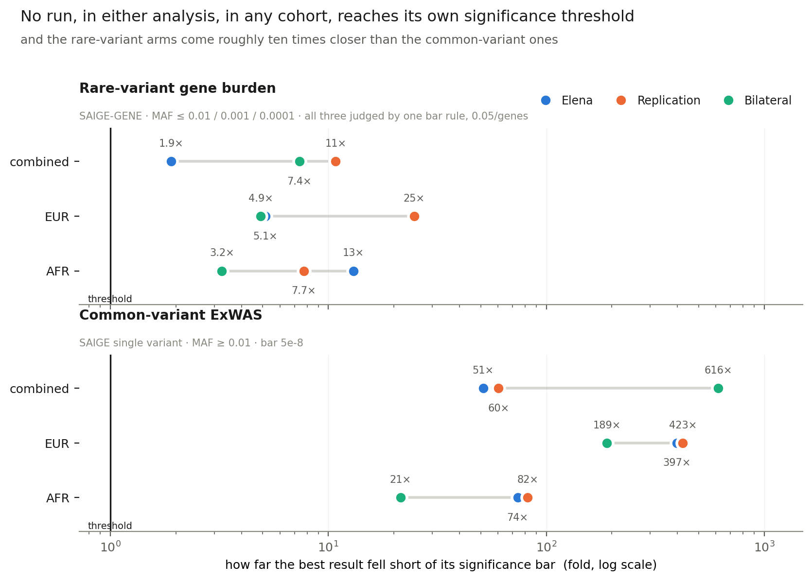

# Hearing loss in PMBB v4 — all results, consolidated

**Hall Lab × Epstein Lab · PMBB-Release-2026-4.0 · October 2026**
Presentation support. Every number is read from the file the analysis wrote; the
script that assembles this is `scripts/01_collect.py`.

---

## The headline

**Six analyses. No gene, no variant, in any cohort, reaches its significance
threshold.** The best result anywhere is 1.9× short; the worst is 616× short.

The second thing the figure says is less obvious and more useful: **the rare-variant
arms land roughly an order of magnitude closer to detection than the common-variant
ones.** Burden runs 1.9–25× short, ExWAS 21–616×. The group's preference for
rare-variant work was argued on biological grounds in the October meeting; this is the
same preference arrived at from the statistics.

---

## What was run

| | Elena (original) | Replication (ours) | Bilateral (ours) |
|---|---|---|---|
| **Rare-variant gene burden** | delivered Jul–Oct 2026 | re-ran and audited | new phenotype |
| **Common-variant ExWAS** | delivered 2 Oct 2026 | re-ran and audited | new phenotype |

Elena never ran a bilateral analysis; that column is new work, not replication.

### Cohorts

| cohort | Elena | Replication | Bilateral |
|---|---|---|---|
| combined | 6,712 / 57,632 | 6,752 / 57,498 | 3,164 / 53,910 |
| EUR | 5,160 / 43,016 | 5,183 / 42,779 | 2,547 / 40,143 |
| AFR | 1,279 / 11,387 | 1,285 / 11,334 | 490 / 10,539 |

*cases / total.* The replication's cohort differs from the original by **+40 cases and
−174 controls** in combined, from two defects found in the case/control rule. The
bilateral cohort is **nested inside** the replication's: the same 50,746 controls, and
every one of its 3,164 cases is also a case there.

---

## Rare-variant gene burden

SAIGE-GENE+ · masks pLOF, pDM, pLOF+pDM · MAF ≤ 0.01, 0.001, 0.0001 · 9 cells per gene,
Cauchy-combined to one omnibus p.

**All three judged by one rule — 0.05 / genes tested — so the columns are comparable.**

| cohort | | genes | min omnibus p | bar | short by | significant |
|---|---|---:|---:|---:|---:|---|
| combined | Elena | 19,042 | 5.00e-06 | 2.63e-06 | 1.9× | none |
| | Replication | 17,943 | 3.02e-05 | 2.79e-06 | 10.8× | none |
| | Bilateral | 17,941 | 2.05e-05 | 2.79e-06 | 7.4× | none |
| EUR | Elena | 18,939 | 1.36e-05 | 2.64e-06 | 5.1× | none |
| | Replication | 17,928 | 6.91e-05 | 2.79e-06 | 24.8× | none |
| | Bilateral | 17,921 | 1.37e-05 | 2.79e-06 | 4.9× | none |
| AFR | Elena | 18,680 | 3.49e-05 | 2.68e-06 | 13.0× | none |
| | Replication | 17,789 | 2.17e-05 | 2.81e-06 | 7.7× | none |
| | Bilateral | 17,778 | 9.14e-06 | 2.81e-06 | 3.2× | none |

> **Footnote for anyone who checks the original tables.** Elena's delivered files report
> **per-cell** p-values, not an omnibus, and correct them within one MAF family:
> `0.05 / 53,583` for combined, verified from her `Pvalue_Bonferroni` column. She ran
> **160,672** cell tests in that cohort, so her bar covers a third of them. Her best cell
> p is 3.33e-06, which is 3.6× short of her own bar. The table above instead recomputes
> her omnibus with our ACAT over the same nine cells, so that all three arms are the same
> quantity. Neither reading produces a significant gene.

---

## Common-variant ExWAS

SAIGE single-variant · MAF ≥ 0.01 · primary bar 5e-8 (the convention, and the poster's).

| cohort | | variants tested | min p | short of 5e-8 | λ | significant |
|---|---|---:|---:|---:|---:|---|
| combined | Elena | 70,429 | 2.57e-06 | 51× | 0.992 | none |
| | Replication | 70,366 | 3.02e-06 | 60× | 0.989 | none |
| | Bilateral | 70,350 | 3.08e-05 | 616× | 1.016 | none |
| EUR | Elena | 74,528 | 1.99e-05 | 397× | 0.991 | none |
| | Replication | 74,536 | 2.12e-05 | 423× | 0.999 | none |
| | Bilateral | 74,566 | 9.47e-06 | 189× | 1.027 | none |
| AFR | Elena | 117,943 | 3.70e-06 | 74× | 1.012 | none |
| | Replication | 117,953 | 4.11e-06 | 82× | 1.021 | none |
| | Bilateral | 118,049 | 1.07e-06 | 21× | 1.013 | none |

A secondary bar of `0.05 / variants tested` was also pre-registered — 7.1e-07, 6.7e-07,
4.2e-07. It is about **ten times looser** than 5e-8, and nothing clears it either.

Of 13,223,743 variants on file, about **0.5%** pass MAF ≥ 0.01.

---

## How well the replication reproduced the original

This is the strongest result in the project, and it is about method rather than biology.

**ExWAS**, joined per variant on `MarkerID`:

| cohort | shared with the delivered run | Pearson r | Spearman ρ |
|---|---:|---:|---:|
| combined | 70,333 (99.9%) | 0.989 | 0.978 |
| EUR | 74,483 (99.9%) | 0.979 | 0.962 |
| AFR | 117,723 (99.8%) | 0.990 | 0.981 |

Every per-variant disagreement larger than one log unit sits in the **MHC** — 14 of 14
in EUR, 16 of 16 in AFR.

**Burden**, top-50 gene overlap:

| cohort | Elena vs Replication | Elena vs Bilateral | Replication vs Bilateral |
|---|---:|---:|---:|
| combined | 18 / 50 | 6 | 9 |
| EUR | 18 / 50 | 6 | 11 |
| AFR | 18 / 50 | 5 | 6 |

The original and the replication share **18 of 50 in every cohort** — the same number
three times, which is what two runs of the same analysis on nearly the same cohort should
look like once the mask and gene-set differences are accounted for. Anything involving
the bilateral arm drops to 5–11, consistent with it being a lower-powered measurement of
a different phenotype rather than a disagreement.

### What differs, and why

| | Elena | ours | effect |
|---|---|---|---|
| gene set | 19,042 | 17,943 | hers includes **651 antisense, 88 LINC, 14 microRNA** genes. A pLOF mask presupposes a protein to lose. Her top burden gene in combined *and* EUR is `TMC3-AS1`, an antisense lncRNA, absent from ours. |
| masks | original | rebuilt | four defects, documented in the replication arm |
| PCs | 5 / 9 / 10 | 5 / 4 / 3 | ours scree-based; see the limitation below |
| cohort | 6,712 cases | 6,752 | two case/control defects corrected |
| burden bar | within one MAF family | across genes | hers covers a third of the tests she ran |

Her delivered burden table also carries **5,391 rows with shifted columns** (from three
files that lost their header) and **954 rows pooled under a `-` pseudo-gene** for
variants VEP could not name. Both are excluded loudly rather than averaged in.

---

## The one positive result

ClinGen Definitive/Strong deafness genes, in the top 50 of each burden arm:

| cohort | | ClinGen in top 50 | expected | p | which |
|---|---|---:|---:|---:|---|
| combined | Elena | 2 | 0.24 | 2.5e-02 | COCH, SIX1 |
| | **Replication** | **5** | 0.26 | **5.9e-06** | COCH, GJB3, MYO6, SIX1, TMPRSS3 |
| | Bilateral | 0 | 0.26 | 1.00 | — |
| EUR | Elena | 4 | 0.25 | 1.1e-04 | — |
| | Replication | 2 | 0.26 | 2.8e-02 | — |
| | Bilateral | 0 | 0.26 | 1.00 | — |
| AFR | Elena | 1 | 0.25 | 2.2e-01 | — |
| | Replication | 0 | 0.26 | 1.00 | — |
| | Bilateral | 0 | 0.26 | 1.00 | — |

**Known deafness genes cluster at the top of the burden rankings far more than chance
allows**, most strongly in the replication's combined cohort — 5 against 0.26 expected.

This says the pipeline works and that real signal sits **below the detection floor**. It
is not a finding about any individual gene: none of the five is significant on its own.

**No pair of arms is statistically distinguishable** on this measure (Fisher p = 0.436,
0.056, 0.678), so the difference between 5 and 2 and 0 should not be over-read.

---

## Two controls, both of which removed a result we wanted

This is the part worth presenting, because in both cases the control destroyed something
already written down.

| | question | answer |
|---|---|---|
| **Burden** (`gene_burden_pmbb_bilateral/phase_5/power_control/`) | the bilateral arm lost the ClinGen enrichment — lost signal, or lost cases? | Five random size-matched draws from the broad cases gave 2, 0, 1, 2, 3 ClinGen genes (pooled 8/250 against 1.3 expected, p = 6.4e-05). **Lost power, not lost signal.** |
| **ExWAS** (`exwas_pmbb_bilateral/phase_5/power_control/`) | restricting the phenotype made some variants *stronger* — subtype specificity, or selection? | Observed 2 / 4 / 8 variants; five random draws gave means of 5.6 / 4.8 / 14.2. Random case removal produces **more** apparent strengthening than the real restriction. **Selection.** `BCAM` is nothing. |

Both decision rules, including what would have counted as inconclusive, were written
before the counts existed.

---

## Why nothing was found

Detectable odds ratio at 80% power, α = 5e-8, single variant:

| | cases | MAF 1% | MAF 5% | MAF 10% | MAF 50% |
|---|---:|---:|---:|---:|---:|
| broad combined | 6,752 | 1.78 | 1.30 | 1.21 | 1.12 |
| bilateral combined | 3,164 | 2.27 | 1.45 | 1.31 | 1.18 |
| broad AFR | 1,285 | 3.76 | 1.83 | 1.55 | 1.30 |
| **bilateral AFR** | **490** | **7.92** | 2.57 | 1.99 | 1.51 |

Common-variant effects on complex, age-related traits sit at **OR 1.05–1.15**. These
cohorts are powered only at the very top of that range, and only for the most frequent
variants. The honest reading of the null is *"no effect larger than this cohort could
see"*.

---

## One limitation of ours

Splitting λ by region exposes a cost of our PC choice that the whole-genome figure hides:

| cohort | λ outside MHC (Elena / ours) | λ inside MHC (Elena / ours) |
|---|---|---|
| combined | 0.990 / 0.989 | **1.145** / 1.041 |
| EUR | 0.992 / 0.995 | 0.965 / **1.339** |
| AFR | 1.012 / 1.020 | 0.998 / **1.092** |

Outside the MHC the runs are indistinguishable. Inside it, in EUR and AFR, **our 4 and 3
PCs leave inflation that her 9 and 10 do not.** No conclusion depends on it — λ = 1.34
across 1,032 variants does not make a 5e-8 result — but nothing targeting the MHC should
inherit 4 PCs unexamined.

---

## One open question, for the group

The summer poster reports **six genome-wide significant ExWAS results**, three unique
variants in `KNL1` and `ZFPM1` at p 3.51e-12 to 6.18e-09.

None appears in the delivered results, in the raw SAIGE output, or in ours. All three
**do** exist in the PMBB v4 release, and all three fail the filter the poster's own
methods describe — *"variants with a genotype call rate < 0.99 … were removed"*:

| variant | call rate | MAF | poster p |
|---|---:|---:|---:|
| chr15:40611486:A:G | **0.2013** | 0.284 | 3.51e-12 |
| chr16:88533289:A:C | 0.9617 | 0.295 | 2.46e-10 |
| chr16:88533290:G:C | 0.9473 | 0.283 | 2.52e-10 |

The variant carrying the 3.51e-12 has a genotype call in **20% of participants**.
Everything we tested sits between call rate 0.9534 and 1.0.

**This is not our results disagreeing with hers** — the two agree at r = 0.99, and her
own `Significance` column reads "Not significant" throughout. The poster disagrees with
the output of the pipeline it describes. The likely explanation is chronology: the
poster predates the October delivery. The question is which variant set produced that
table. Details in [`memo_poster_qc.md`](../exwas_elena_replication/confluence/memo_poster_qc.md).

---

## What the set says

1. **Nothing is significant anywhere**, under any phenotype, either method, any cohort,
   and under each run's own bar as well as under a common one.
2. **The pipeline works.** Known deafness genes cluster at the top of the burden
   rankings at p = 5.9e-06, and the ExWAS reproduces the delivered run at r = 0.99.
3. **The limiting factor is the cohort.** Two independent controls reached this
   separately — one through ClinGen enrichment, one through strengthening variants.
   Neither the phenotype definition nor the method is what is holding the result back.
4. **Rare-variant work is the better use of this data**, by a factor of about ten in how
   close it gets, which agrees with the group's biological judgement.
5. **Sharpening the phenotype costs more power than it buys specificity** at this size.
   Bilateral sensorineural halves the cases; both controls show the loss dominates.

### Suggested next steps

| | |
|---|---|
| Resolve the poster's variant set | the only item that is not ours to settle |
| More cases, not more methods | every arm is power-limited; another analysis of the same 6,752 cases will not change this |
| Revisit PCs if the MHC matters | 4 and 3 are enough genome-wide and not enough there |
| Not: more common-variant work on this cohort | the power table is the argument |

---

## Where everything is

| arm | folder |
|---|---|
| burden, broad | `analysis/gene_burden_elena_replication/` |
| burden, bilateral | `analysis/gene_burden_pmbb_bilateral/` |
| ExWAS, broad | `analysis/exwas_elena_replication/` |
| ExWAS, bilateral | `analysis/exwas_pmbb_bilateral/` |
| this synthesis | `analysis/synthesis/` |

Each arm carries `PREMISES.md` (pre-registered), per-phase `FINDINGS.md`, a Confluence
close-out, and Portuguese walk-throughs in `andre_notes/`.
